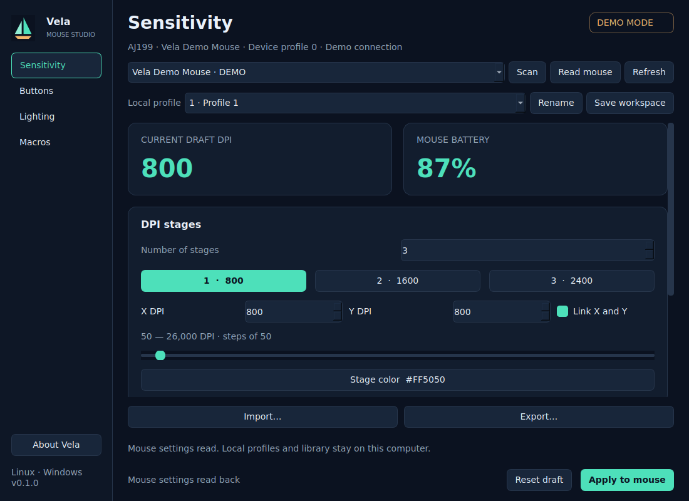

# Vela Mouse Studio

**[Portugu?s: instala??o passo a passo](README.pt-BR.md)**


[](https://github.com/a32fred/vela-mouse-studio/actions/workflows/tests.yml)

**Independent AJ199 configuration utility - early development preview.**

[Linux setup](#install-and-launch) | [Contributing](CONTRIBUTING.md) | [Security](SECURITY.md) | [Changelog](CHANGELOG.md) | [MIT license](LICENSE)

An independent, native Qt Widgets controller for the AJ199 mouse, with original Vela sail branding. Four pages cover sensitivity, six button assignments, lighting, and a local macro library. No browser, online fonts, or vendor application is required.

Python 3.10+ is supported by the source. Install a Python version and architecture for which PySide6 and HIDAPI provide wheels. Development verification used Windows, Python 3.14 and PySide6 6.12; Headless Ubuntu 24.04 CI has passed with Python 3.10 and 3.13. Live desktop sessions, USB permissions and physical mouse writes have **not** been validated. Demo mode uses an in-memory transport with the same report codecs and service as real connections.



The screenshot is an Ubuntu 24.04 offscreen Qt demo render, without a physical device. **97 tests passed** on Windows and on each Linux CI job (Python 3.10 and 3.13), including builds and demo rendering. See [the passing Linux run](https://github.com/a32fred/vela-mouse-studio/actions/runs/40155183815) and [validation evidence](docs/VALIDATION.md).

## Install and launch

There is no RPM, Flatpak or one-click installer yet. Install from this repository using the steps below. You do not need a GitHub account or a developer setup.

### Fedora Workstation / KDE: start here

Open **Terminal** and run each numbered block in order. This recipe targets Fedora installations with `dnf`; Atomic desktops such as Silverblue/Kinoite need a different setup. Fedora installation and real USB access have not yet been tested hands-on; the automated Linux checks currently use Ubuntu.

**1. Install the prerequisites (once).** Enter your login password if asked; the terminal does not display password characters. Confirm DNF's package list when prompted.

```sh
sudo dnf install git python3 python3-pip \
  libglvnd-egl libglvnd-glx libxkbcommon-x11 \
  xcb-util-cursor xcb-util-wm xcb-util-keysyms
```

**2. Download and install Vela.** This creates a `vela-mouse-studio` folder inside your home directory. Keep that folder: the launcher uses the Python environment stored inside it. The dependency download can take a few minutes.

```sh
cd "$HOME"
git clone https://github.com/a32fred/vela-mouse-studio.git
cd vela-mouse-studio
python3 -m venv .venv
.venv/bin/python -m pip install --upgrade pip
.venv/bin/python -m pip install -e .
```

If you already downloaded the repository, skip `git clone` and enter its existing folder instead. If a command fails, stop there and read [Troubleshooting](#installation-troubleshooting); do not continue with an incomplete installation.

**3. Open the demonstration first.** No mouse connection or USB permission setup is needed. A Vela window with a **DEMO MODE** badge should open.

```sh
sh "$HOME/vela-mouse-studio/run-vela" --demo
```

**4. Use your actual mouse.** Close the demo. Install the supplied USB access rule once:

```sh
cd "$HOME/vela-mouse-studio"
sudo install -m 644 packaging/linux/70-vela.rules /etc/udev/rules.d/70-vela.rules
sudo udevadm control --reload-rules
```

Unplug and reconnect the mouse's USB cable. Then open real mode:

```sh
sh "$HOME/vela-mouse-studio/run-vela"
```

Inside Vela, click **Scan**, select the AJ199, then click **Read mouse**. These actions read settings; only **Apply to mouse** writes your changes. Run Vela as your normal desktop user, not with `sudo`. Hardware writes are still experimentally unvalidated.

**Open it again later:** use the same `sh "$HOME/vela-mouse-studio/run-vela"` command from any terminal. For an application-menu shortcut, follow [Desktop shortcut](#desktop-shortcut-optional). For demo mode, add `--demo`.

**Update an existing installation:** close Vela, then run:

```sh
cd "$HOME/vela-mouse-studio"
git pull --ff-only
.venv/bin/python -m pip install -e .
```

### Other Linux distributions

Install Git, Python 3.10+ with `venv`/pip, and the Qt runtime libraries through your distribution's package manager. Package names differ; do not run Fedora's `dnf` command on another distribution. Then follow Fedora steps 2?4 above, which use the same repository and launcher. If you extracted a source archive, enter its folder instead of cloning and adjust the launcher path accordingly. PySide6/HIDAPI must provide compatible binaries for your Python version and architecture.

### Windows preview

From the downloaded repository in PowerShell:

```powershell
py -3 -m venv .venv
.venv\Scripts\python.exe -m pip install -e .
.\run-vela.cmd --demo
```

### Installation troubleshooting

| What you see | What to do |
|---|---|
| `git: command not found`, `python3: command not found`, or no `pip` | Complete step 1 before continuing. |
| `destination path ... already exists` | Use `cd "$HOME/vela-mouse-studio"`; do not clone again into the same location. |
| `No matching distribution found` / unsupported Python or architecture | Run `python3 --version` and check that PySide6/HIDAPI support that interpreter/architecture. Report the complete error using the bug template; do not replace the system Python. |
| Missing `.venv/bin/python`, `No module named vela`, or launcher asks you to install first | Complete step 2 successfully, in the repository folder. |
| Qt reports `xcb` / a missing shared library | Complete the Fedora runtime package installation in step 1. If it still fails, include the exact missing library in a bug report. |
| Demo opens but real mode reports permission denied | Complete step 4 and physically reconnect the cable in your active desktop session. Do not run the GUI as root. |
| Scan finds no supported device | Check the cable and connection. The supplied rules match USB IDs `25a7:fa7b` and `25a7:fa7c`; other IDs are unconfirmed. |

[Fedora Python/pip guidance](https://developer.fedoraproject.org/tech/languages/python/pypi-installation.html) ? [Fedora EGL package](https://packages.fedoraproject.org/pkgs/libglvnd/libglvnd-egl/) ? [Fedora XCB cursor package](https://packages.fedoraproject.org/pkgs/xcb-util-cursor/)

## Use

In real mode choose **Scan**, select a device, then **Read mouse**. Reading adopts its settings into the current draft. The simulator connects automatically with `--demo` and is visibly labeled. On demo startup, a saved local profile remains in the draft and is compared with the simulator's current settings; Apply remains explicit. **Refresh** reads status while preserving draft edits. Changing pages retains the draft.

Edit DPI stages (1–6, separate X/Y from 50 to 26000 in steps of 50), polling, debounce, lift-off distance, angle snapping and ripple filtering. Lighting offers steady, breathing, neon, color breathing and off, with effect-specific controls. Six button editors support standard mouse actions, supported media actions, explicit keyboard combinations and library macros. Existing unknown assignments stay preserved through unrelated edits.

**Apply to mouse** explicitly writes and checks the current draft. Opening the app, selecting local profiles, imports and local saves do not apply settings. Apply is disabled during device work; the UI stays responsive. Failed application preserves the draft and reports whether the mouse may contain some changes. Reconnect to read its actual state; there is no device rollback guarantee.

The four **Local profile** slots are saved settings on this computer. Choosing one stages its settings; it does not switch a hardware bank. The reported **Device profile** number is shown as received; independent device profile banks and their count are unconfirmed. **Reset draft** restores the last mouse read, or the local profile when disconnected. Save local work explicitly before exiting; unsaved changes are not recovered after closing.

**Save workspace** atomically stores all four local profiles and the macro library. The default file is `$XDG_CONFIG_HOME/vela/workspace.json`, falling back to `~/.config/vela/workspace.json` (also on Windows). Choose a separate directory with `--workspace PATH`. An invalid existing workspace is reported and preserved; export a backup or restart with another directory to recover safely. Concurrent app instances are not coordinated.

**Import… / Export…** offer a complete native JSON workspace backup, plus the supported legacy JMA/DCT subset. A native import replaces the in-memory workspace only; save explicitly to keep it. JMA imports stage the current profile. DCT imports replace the first one to four local profile slots. Legacy parsing is bounded; unknown pointer-like values are never used as addresses.

Legacy JMA cannot represent all freshly created bindings. In particular, a fresh default profile **cannot** be exported to JMA because several standard-button encodings are not established. The app gives the reason and offers native workspace export. JMM import/export is available in Macros; unsupported or lossy event encodings are rejected. See [format compatibility](docs/reference/FORMAT_COMPATIBILITY.md) for exact boundaries.

In **Macros**, create or import a sequence, edit its name, loop mode/count and ordered events, then save the workspace. Use down/up/move events with decimal or `0x` HID usages, delay in milliseconds and movement X/Y. Add/remove/reorder individual events. Keyboard codes are USB HID usages, not ASCII or Windows virtual keys. The editor accepts at most 70 events, delays 0–65535 ms and repeat 1–250. Hardware names retain at most 15 UTF-16 units; the local library retains its complete name (up to 39). Hardware movement components must fit −128…127. Unsupported usages, wheel events and combinations exceeding the 32-byte slot fail explicitly when applied/exported.

**Start recording** focuses a recording area. Only input directed to that area is captured; leaving it stops recording and releases held inputs. There is no global keyboard hook. Logical key mapping follows the active keyboard layout; Qt logical modifier keys use the left Ctrl/Shift/Alt/Super usages (AltGr uses right Alt). Use explicit HID codes in the event editor for a side-specific modifier. Mouse movement records local pointer deltas while dragging in the area, not raw device motion. Review before applying. Record timing uses measured delays; turning it off uses the chosen fixed delay. Counted, while-held and toggle loop modes map to the supported device encodings.

## Read-only CLI and preview

```sh
python -m vela --cli scan --demo
python -m vela --cli status --demo
python -m vela --cli scan
python -m vela --cli status --device EXACT_ID_FROM_SCAN
python -m vela --cli dump --device EXACT_ID_FROM_SCAN --length 0x1000
python -m vela --cli listen --device EXACT_ID_FROM_SCAN --seconds 30
python -m vela --demo --screenshot artifacts/vela.png --workspace artifacts/preview-workspace
```

The CLI prints JSON and exits 0 on success, 1 on connection/read failure, 2 on argument errors. `scan` lists stable IDs and metadata; `status` requires `--device` if several devices are found. `--demo` can occur before or after the CLI command. `dump` reads the first bytes of the mouse's memory as hex (default 0x1000) and `listen` prints the unsolicited reports the mouse sends, for example when you press the DPI button. None of the CLI commands writes settings. CLI operation imports no Qt modules. Preview requires `--demo` and closes cleanly after saving its PNG. For headless preview/tests set `QT_QPA_PLATFORM=offscreen`.

## Linux access and desktop integration

The optional [udev rules](packaging/linux/70-vela.rules) grant active-seat access only to HID devices `25a7:fa7b` and `25a7:fa7c`. Review before installing. These commands require administrator privileges and are **not** run by Vela:

```sh
sudo install -m 644 packaging/linux/70-vela.rules /etc/udev/rules.d/70-vela.rules
sudo udevadm control --reload-rules
# Replug the mouse, then run Vela as your normal desktop user.
```

On machines without an active logind/seat session, your administrator may need a distro-appropriate group policy. Do not run the GUI as root to work around permissions. Access failure is reported by Scan/Read mouse.

### Desktop shortcut (optional)

For a per-user launcher, from the repository root:

```sh
mkdir -p "$HOME/.local/share/applications" "$HOME/.local/share/icons/hicolor/scalable/apps"
install -m 644 src/vela/assets/vela.svg "$HOME/.local/share/icons/hicolor/scalable/apps/vela.svg"
# Use the absolute venv executable, so no activated shell is needed.
sed "s|^Exec=.*|Exec=\"$PWD/.venv/bin/vela\"|" packaging/linux/vela.desktop > "$HOME/.local/share/applications/vela.desktop"
```

Keep the repository/venv at that location, or update the launcher after moving it. Installation packages may use the provided desktop file unchanged when `vela` is installed on the desktop's PATH. Uninstall by removing the copied desktop/icon/rules and the virtual environment; local workspace data remains until you remove it.

## Contributing

Bug reports, documentation improvements and simulator-backed changes are welcome. Start with [CONTRIBUTING.md](CONTRIBUTING.md), follow the [code of conduct](CODE_OF_CONDUCT.md), and use [SECURITY.md](SECURITY.md) for potential vulnerabilities. Hardware testing is optional; report exactly what you tested and leave unknown behavior marked unconfirmed.

## Development and limits

```sh
python -m pip install build
QT_QPA_PLATFORM=offscreen python -m unittest discover -s tests -v
python -m build
```

Tests use fake HID APIs and the simulator; they do not enumerate, open or write physical devices. Linux CI has [passed on Ubuntu 24.04 with Python 3.10 and 3.13](https://github.com/a32fred/vela-mouse-studio/actions/runs/40155183815), including offscreen widget tests, builds, demo CLI and rendering. Protocol correctness is checked with specification-derived vectors and readback simulation. Actual hardware writes/playback, Linux permissions and live desktop behavior need separate hands-on validation.

All GUI service work runs on one queued worker; shutdown waits for the current transaction, closes its handle and ends the thread without blocking the GUI. HIDAPI `send_feature_report` has no configurable OS timeout. An indefinitely stalled native driver call cannot be safely interrupted; shutdown may wait indefinitely in that case. Vela never force-terminates a thread.

Firmware updates, factory reset, ambiguous sensor/sleep features and Windows host-pointer settings are unavailable. No physical writes were performed during development.

## Provenance and licenses

Vela's new code and original logo are MIT-licensed; see [LICENSE](LICENSE). Implementation was written from this repository's behavioral specification and approved design, without inspecting vendor executables, decompiled source, vendor images or adjacent research artifacts. The original sail logo is included locally at `src/vela/assets/vela.svg`; no hosted design service or remote asset is required at runtime.

Dependencies retain their own licenses. See [THIRD_PARTY_NOTICES.md](THIRD_PARTY_NOTICES.md). Vela is an independent compatibility utility, with no claim of manufacturer affiliation.
